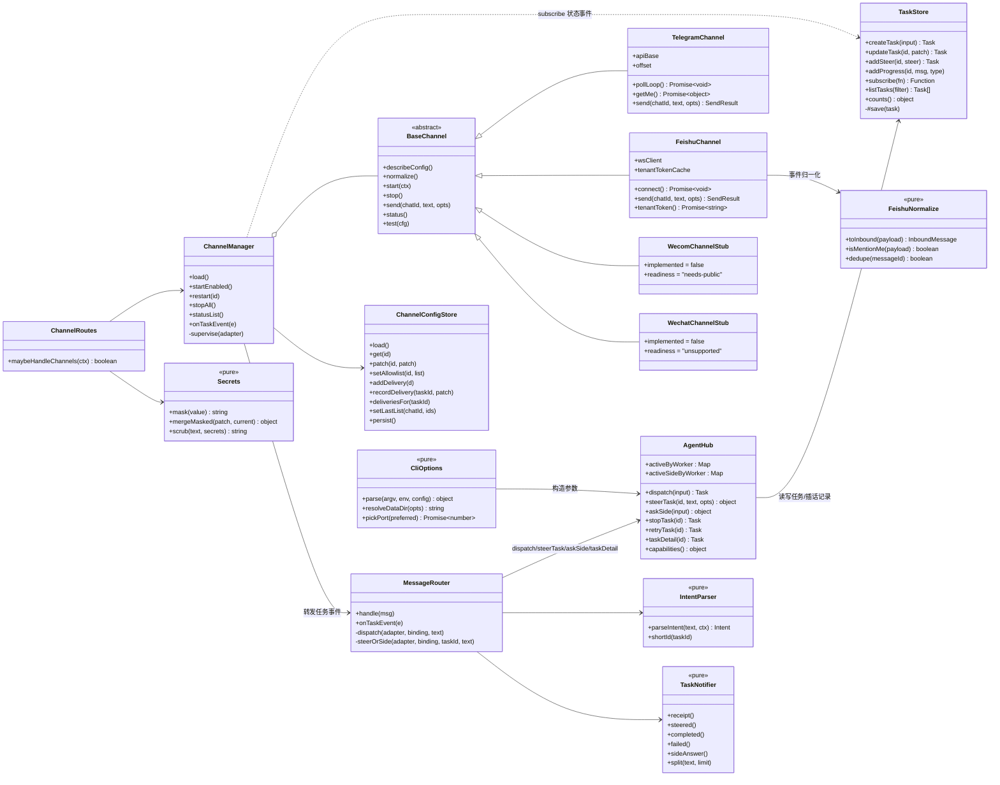
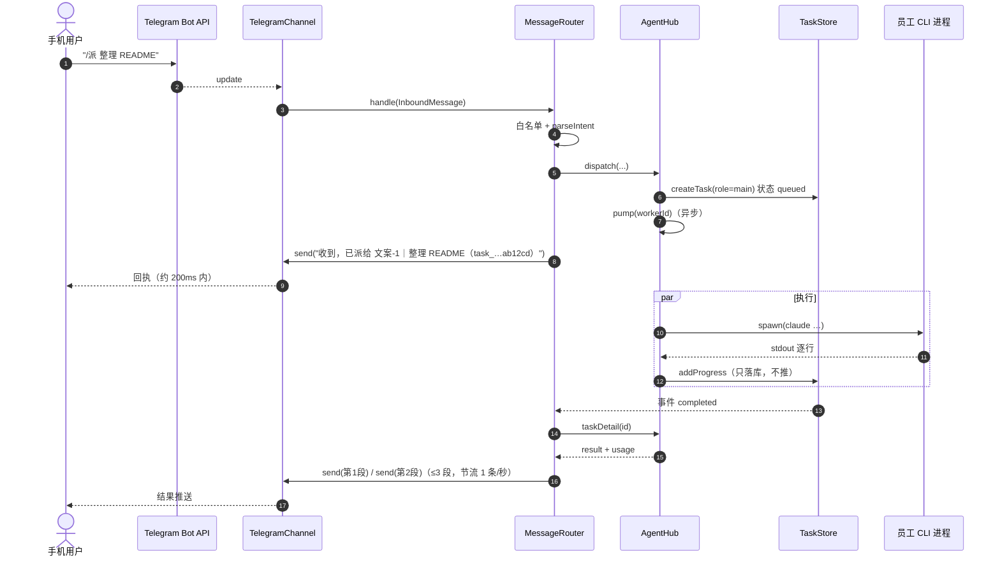
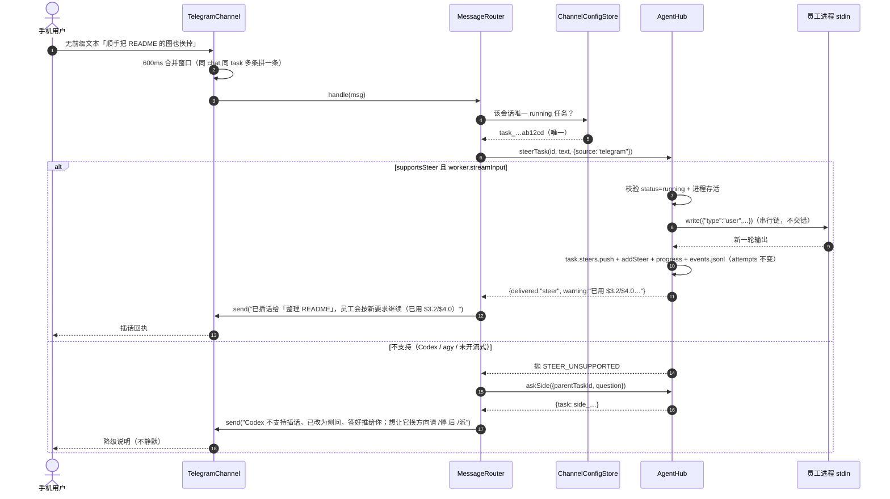
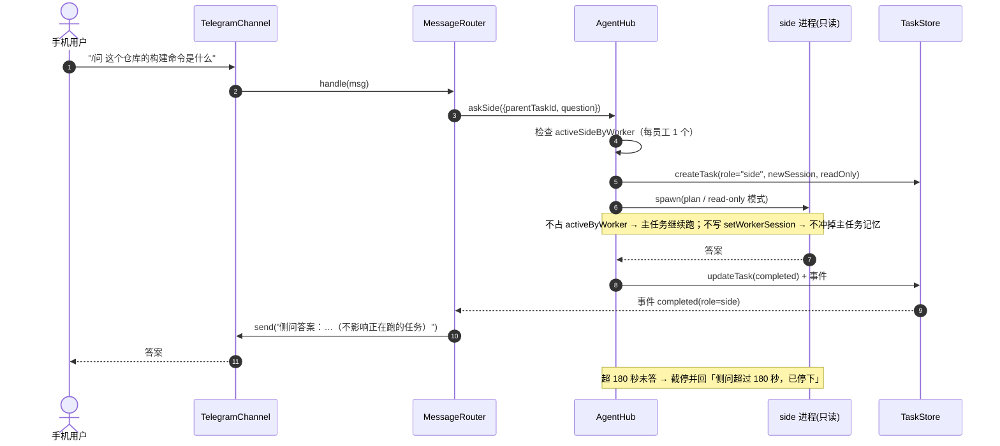
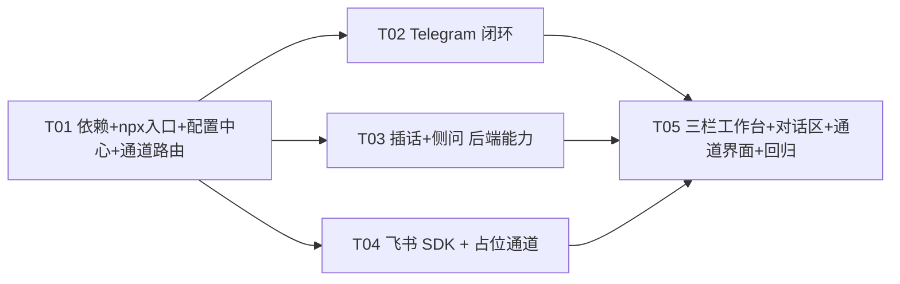

# DSH Agent Hub v0.7.0 系统设计：IM 通道层 + 任务中对话 + 三栏工作台

> 作者：高见远（Architect）｜基线 0.6.0（commit `444cdcd`）｜本版 v2（并入需求 C 与依赖放宽）
> 本文只做设计，不含实现代码。

---

## §0 变更说明（v1 → v2）

| # | 变更 | 影响章节 |
|---|---|---|
| 1 | **并入需求 C：插话（steer）+ 侧问（side）**，含各 adapter 支持矩阵、状态机、落盘、合并策略、预算共存 | §1.4、§1.9、§2、§3.7、§3.8、§3.9、§3.11、§4、§7 T03 |
| 2 | **约束放宽：允许 npm 依赖**。飞书改用官方 SDK，手写 protobuf 降为备选 | §1.5、§2、§6、§7 T04 |
| 3 | **新增可安装性设计**（`npx` 直跑：端口/数据目录/参数不写死） | §1.10、§2、§7 T01 |
| 4 | 意图解析新增「任务在跑时无前缀文本 = 插话」的确定性规则（不再一律当派活） | §3.5 |
| 5 | 「待明确事项」从原 Part B §8 移到 **§5**（符合章节规范），Part B 顺延为 §6–§9 | §5 |
| 6 | 上一封消息末尾依赖图被截断，本版 §9 为完整版 | §9 |

**未变部分**：§1.1 现状复核、§1.2 分层边界、§1.3 in-process 取舍、§1.6 崩溃隔离、§1.7 脱敏、§1.8 不破坏现有行为、§3.1–§3.6、§8 大部分条目。

**本版新查证的事实**（不是推测）：

- `src/adapters/claude.mjs:26` 的 `-p` 是**开关**、prompt 走 stdin；`test/fake-claude.mjs` 等 stdin `end` 才输出 → 流式输入必须**默认关闭**，否则 46 项测试全挂。
- `codex.mjs:39-40`、`agy.mjs:16-18` 把 prompt 当**位置参数**、stdin 立即 end → 这两类**结构上不可能插话**。
- `@larksuiteoapi/node-sdk` 最新 **1.76.0**，unpacked **30.26 MB**，直接依赖 `axios / ws@^8.19 / protobufjs@^7.2.6 / qs / lodash.merge / lodash.pickby / lodash.identity`，**纯 JS，无 native 编译**（`ws` 的 `bufferutil`/`utf-8-validate` 是 optional，不装也不编译）。
- 基线 `npm test` = **46/46 全绿**（17.8s），作为回归闸门。

---

# Part A 系统设计

## §1 实现方案与关键取舍

### 1.1 现状复核（读代码确认）

| 事实 | 证据 |
|---|---|
| Node v22.22.2，`WebSocket`/`fetch`/`AbortSignal.timeout`/`util.parseArgs` 均内置 | 实测 |
| `package.json` 无 dependencies | `package.json` |
| HTTP 只监听 `127.0.0.1`，`loopbackHost` + `allowedOrigin` 双重校验，外部 403 | `server.mjs:47-66,143-150` |
| 路由为单一 if 链；静态资源只放行 5 个固定名字 | `server.mjs:156-163` |
| 任务状态唯一漏斗 `TaskStore.#save()` | `store.mjs:147-159` |
| `stageOf()` 服务端派生、不落盘 | `store.mjs:31-48` |
| `runStream` 写完 stdin 立即 `end()`，之后无任何入口 | `adapters/shared.mjs:96-101` |
| `activeByWorker` 保证一个员工同时只跑一个任务 | `hub.mjs:164-169` |
| 面板原生 JS 单文件 1173 行；`plugin/client.mjs` 只是 iframe（DSH 侧栏约 380px） | `public/app.js`、`plugin/client.mjs:28-40` |
| `loadConfig` 用 `resolve(PROJECT_ROOT, dataDir)` → 数据目录绑死源码目录，**npx 场景不可用** | `server.mjs:125` |

### 1.2 分层：三个入口 + 一条新支路

```
手机用户 → channels/（入站交互）
DSH 侧栏 → plugin/  ─┐
Web 面板 → server.mjs ┘（HTTP 入口，仍是唯一对外 API）
              ↓
         AgentHub（编排：队列/状态机/重试/插话/侧问）
              ↓
         adapters/（出站执行：spawn CLI）
```

| 层 | 职责 | 禁止 |
|---|---|---|
| `adapters/` | 任务→CLI 子进程；解析输出；**声明是否支持插话** | 不碰网络、不碰通道概念 |
| `channels/` | 收外部消息→鉴权→意图解析→调 Hub→回推 | **不得 import adapters、不得 spawn、不得直接改 store** |
| `plugin/`、`public/` | 另一个入口 | 不碰内部模块 |

口径：**adapters 是「派活给 CLI」，channels 是「收外部消息」**；插话/侧问属于**编排（Hub）**——既不是 adapters 的职责，也不是 channels 的职责。通道只负责把用户那句话送进 `POST /api/tasks/:id/say`，怎么执行由 Hub 决定。这是本版最重要的边界修正。

### 1.3 通道 in-process 直调 Hub（沿用 v1 结论）

省序列化、不受 loopback 校验与端口变更影响、测试可注入假 hub；代价是与 Hub 同生命周期（同一进程，可接受）。方法名与 HTTP 一一对应，将来拆进程只换 bridge。

### 1.4 插话与侧问的总原则

| 维度 | 插话 steer | 侧问 side |
|---|---|---|
| 本质 | 给**正在跑的任务**追加一条用户消息 | **另起一个只读短任务**回答问题 |
| 影响主任务 | 是（改变走向、延长耗时） | 否（答案不回灌主任务） |
| 依赖能力 | CLI 必须支持流式输入 | 任何 adapter 都行 |
| 会话记忆 | 同一会话内追加 | 强制新会话，且**不写回**会话记录 |
| 失败处理 | 不支持 → **自动降级为侧问并明说** | 超时 → 截停并明说 |
| 可见性 | `task.steers[]` + 进度条目 + `events.jsonl` | 独立 task（`role:"side"`），可查可看 |

**绝不允许静默失败**：`steerTask` 的每种拒绝都带中文原因 + 错误码，通道原文转述，绝不吞。

### 1.5 平台可行性与插话支持矩阵

**IM 平台**

| 平台 | 接收方式 | 实现方式 | 结论 |
|---|---|---|---|
| Telegram | `getUpdates` long polling | **内置 fetch 手写**（约 120 行，不引包） | ✅ |
| 飞书 | WS 长连接（`POST /callback/ws/endpoint`） | **`@larksuiteoapi/node-sdk@1.76.0`**：`WSClient` + `EventDispatcher` | ✅（v1 手写 protobuf 降为 Plan B，见 §5-1） |
| 企业微信 | 需公网回调 | 占位 `implemented:false, readiness:"needs-public"` | 下一阶段 |
| 个人微信 4.1.15 | wcferry 等不支持 4.x | 占位 `implemented:false, readiness:"unsupported"` | 单独立项 |

**员工插话支持矩阵（必须逐条反馈给用户）**

| 员工类型 | `kind` | 插话 | 技术依据 | 不支持时的降级反馈 |
|---|---|---|---|---|
| Claude | `claude-cli` | ✅（需开「允许插话」） | `-p` 是开关、prompt 走 stdin；加 `--input-format stream-json` 后 stdin 可保持打开，逐行写 `{"type":"user",...}` 触发新一轮 | — |
| Codex | `codex-cli` | ❌ 永不支持 | `codex exec <prompt>` prompt 是位置参数，一次性执行，无持续输入入口 | 「Codex 不支持插话，已改为侧问」+ 侧问答案 |
| 反重力 | `agy-cli` | ❌ | `-p <content>` 位置参数，同上 | 同上 |
| 未来类型 | — | 由 `supportsSteer` 声明，默认 `false` | — | 同上 |

**流式输入的三个前提**（写进实现注释）：
1. 必须同时有 `--output-format stream-json --verbose`（现状已满足，`claude.mjs:27-29`）。
2. stdin 不能 `end()`；改为「收到 `result` 事件 + 空闲 3 秒无新插话 → 主动 `end()`」，让进程正常退出，**`start/done` 契约完全不变**（`done` 仍在 `close` 时 resolve）。
3. 首条 prompt 也要转成 JSONL user 消息（不再写纯文本），否则 stream-json 解析失败。

### 1.6 崩溃隔离与重启恢复

每通道一个 supervisor：抛错 → `state:"error"` + `lastError` → 指数退避（1s→60s）→ 连续 20 次转 `stopped` 提示人工。通道内所有异步入口包 catch；`onTaskEvent` 用 `Promise.resolve().catch()` 兜底。**任何通道异常都不会 reject 到 HTTP 链路、不会让进程退出**。启动 `load()+startEnabled()`（不 await）；关闭先 `channelManager.stopAll()` 再 `hub.stopAll()`。飞书同 appId 单连接守卫（`restart` 时先 `stop()` 旧实例）。

### 1.7 脱敏

存储 `data/channels.json` 明文（与 `data/workers.json` 同一安全假设，已在 `.gitignore` 的 `data/*` 内）；`GET /api/channels` 恒返回 `****a1b2`；`PUT` 传空或等于掩码 → 保留原值，清空须显式 `clearToken:true`；`scrub()` 兜日志与错误（**Telegram 报错会把 `/bot<token>/` 带进 URL；飞书 SDK 的 logger 也会打 appId，需把 SDK logger 收口到我们的 logger 再 scrub**）。

### 1.8 不破坏现有行为

- `server.mjs` 只追加（装配、通道路由、静态白名单 5→8 项、`allowedHosts` 可配）。
- `store.mjs` 只追加（`subscribe()`、`addSteer()`、`role` 字段、`counts.side`），原字段与语义不变。
- `hub.mjs` 追加 `steerTask` / `askSide`，**`pump` 一行不改**（侧问不复用 pump，见 §1.9-F）。
- `adapters/shared.mjs` 加 `streamInput` 可选参数，**默认 false 时行为与现在逐字节相同**。
- 46 项测试零改动全绿；`fake-claude.mjs` 不动（新路径用新桩 `fake-claude-stream.mjs`）。

### 1.9 插话 / 侧问的具体设计

**A. 状态机（插话不动状态）**

| 任务当前状态 | 插话结果 | 依据 |
|---|---|---|
| `running` 且有活进程 | 接受，**仍为 `running`** | 不新增状态，`stageOf`/面板/测试全不用改 |
| `queued` | 拒绝 `STEER_NOT_RUNNING`：「任务还在排队，等它开始跑再插话；想撤就发 /停」 | 排队任务没有进程 |
| `retrying` | 拒绝：「正在等自动重试，现在插话会被丢掉；等它跑起来或 /停 掉重派」 | 进程已死 |
| `cancelling` | 拒绝：「任务正在停止」 | 同上 |
| `waiting`/`failed`/`interrupted` | 拒绝：「任务已经停下了，用 /重派 再来一次，或 /问 侧问」 | 无进程 |
| `completed`/`cancelled` | 拒绝：「任务已结束，用 /看 看结果或直接派新任务」 | 无进程 |

- `attempts` **不变**：attempts 是「执行尝试次数」，插话不是重试，改了会让重试计数虚高。
- `nextRetryAt` 不变（running 时本为 null）；`startedAt` 不重置 → 耗时如实包含被插话拉长的时间。
- 新增 `steerCount` 与 `lastSteerAt`（仅展示，不参与任何策略）。

**B. 落盘与可追溯（三条都写，冗余是有意的）**

1. `task.steers[]`：`{ at, text(≤4000), parts?, source, actor?, delivered, error? }`，上限 50 条 FIFO → 面板右栏「对话」区可见。
2. `task.progress` 追加 `"主控插话：<前 120 字>"`（type `"steer"`）→ 进度时间线可对齐"第几分钟说了什么"。
3. `events.jsonl` 追加 `{type:"steer", taskId, text(≤1000), source, chatId}` → 事后 `grep` 可查「谁在什么时候说了什么」。

**C. 连发三条：通道层合并、Hub 层不合并**

- Hub 的 API 语义直白：一次调用 = 一条插话（不做时间窗口魔法，避免"我发了两条却只记了一条"）。
- **通道层**（手机场景）600ms 合并窗口：同 chat + 同 taskId、窗口内多条 → `\n\n` 拼成一条发出，记录保留 `parts:["原1","原2","原3"]`。理由：手机输入法把一句话拆成多次提交很常见，逐条发会让员工收到半句话就跑一轮。
- 同 taskId 的 stdin 写操作用 **promise 串行链**，杜绝交错写坏 JSONL。

**D. 与预算刹车共存**

- 预算检查逻辑**一行不改**：仍在每轮 `result` 后由 `isBudgetExhausted` 判定 → `#finishFailure(retryable:false)` → 落 `waiting`，结果保留。
- 插话会开启新一轮 → 自然多消耗。`steerTask` 在 `costUsd / maxBudgetUsd > 0.8` 时**不阻止**，但返回值带 `warning:"已用 $3.2 / 上限 $4.0，插话会继续消耗，到顶就停"`，通道与面板必须显示。
- 触顶后进「等你」，后续插话因状态非 running 自然被拒——不引入第二套会计路径。

**E. 无响应保护**：插话后 90 秒内该任务无新 progress → 加一条进度「插话后 90 秒没有新输出，员工可能没在响应」，**不自动杀**（人判断）。

**F. 侧问（side）的独立执行路径**

- 不复用 `pump`（pump 与 `activeByWorker` 强绑定，硬塞会破坏员工互斥语义和现有测试），新增 `hub.askSide()` 约 60 行：
  - 建 task：`role:"side"`、`parentTaskId`、`newSession:true`、`resumeSessionId:null`、`title:"侧问 · <问题前 40 字>"`。
  - **强制只读**：claude→`plan`，codex→`read-only`，agy→`plan`（侧问只答疑，这也让"不打断主任务"有实际保证）。
  - **不写会话记忆**：`hooks.onSession` 不调 `setWorkerSession`（否则侧问会把主任务记忆冲掉——最容易埋的坑）。
  - 并发：`activeSideByWorker` 每员工最多 1 个；超了回「这个员工正在回答上一条侧问，等它答完」。**不占 `activeByWorker`**，主任务照跑。
  - 超时：默认 180 秒（`worker.sideTimeoutMs` 可配），到点按 `stopTask` 同款 kill，`error:"侧问超过 180 秒，已停下"`。
  - 上下文：主任务标题 + prompt 前 800 字 + 最近 5 条进度 + 问题，拼成结构化 prompt（见 §3.7）。
- 侧问是**完整 task**，「事后能查」免费获得：`GET /api/tasks?role=side`、`/api/tasks/:id`、面板「含侧问」开关、`/任务` 命令都能看。

### 1.10 可安装性（npx 直跑，不写死任何东西）

现状问题：`loadConfig` 把 `dataDir` 解析到源码目录（`server.mjs:125`），`npx` 跑时 cwd 是用户目录、包目录只读且随升级被替换 → 数据会丢。改造：

| 项 | 优先级（高→低） | 默认 / 规则 |
|---|---|---|
| 端口 | `--port` > `AGENT_HUB_PORT` > `config.port` > `4647` | 占用时自动 +1 最多 10 次并打印实际端口；`--port 0` 交系统 |
| 绑定地址 | `--host` > `AGENT_HUB_HOST` > `127.0.0.1` | 回环 |
| 数据目录 | `--data-dir` > `AGENT_HUB_DATA_DIR` > `config.dataDir`（相对 cwd）> **探测 `./data` 含 `tasks/` 或 `workers.json` 则沿用**（兼容"项目内运行"的老用户）> 平台默认 | win `%LOCALAPPDATA%\dsh-agent-hub\data`；mac `~/Library/Application Support/dsh-agent-hub`；linux `$XDG_DATA_HOME/dsh-agent-hub` 或 `~/.local/share/...` |
| 配置文件 | `--config` > `AGENT_HUB_CONFIG` | `<dataDir>/config.json`（不再依赖源码内 `config/workers.json`） |
| 通道 | `--no-channels` 偏关；否则按 `data/channels.json` 的 `enabled` | 跟随配置 |

- 新增 `bin/dsh-agent-hub.mjs`（`#!/usr/bin/env node`），用 `node:util parseArgs`；`package.json` 加 `"bin"`、`files` 加 `bin`、提交 `package-lock.json`。
- CLI：`--port --host --data-dir --config --open --no-channels --log-level --version --help`（help 全中文）。
- `--host` 非回环时：横幅红字警告 + `/api/health` 带 `warning`；`loopbackHost()` 改为读 `config.allowedHosts`（默认仍是三个回环值 → **现有测试与行为不变**）。
- 启动横幅打印：版本、数据目录、配置文件、实际地址、各通道状态——用户永远知道数据在哪。
- `public/` 与静态资源已用 `import.meta.url` 定位（`server.mjs:13-14`），npx 下天然正确，无需改。
- 升级不丢数据：数据目录独立于包目录，`npx ...@latest` 只换代码。

---

## §2 文件清单

图例：`＋新增` `～修改`

### 后端 · CLI / 配置 / 编排（T01、T03）

```
bin/dsh-agent-hub.mjs            ＋ npx 入口：parseArgs、端口/地址/数据目录、启动横幅
src/cli-options.mjs              ＋ 纯函数：argv+env+config 合并、数据目录探测、端口占用重试
src/config.mjs                   ＋ 统一配置装配（原 loadConfig 迁移 + allowedHosts）
src/server.mjs                   ～ 挂通道路由、静态白名单 5→8、allowedHosts、shutdown 停通道、/api/tasks/:id/say
src/store.mjs                    ～ subscribe()、addSteer()、role/steers 字段、counts.side、listTasks(role)
src/hub.mjs                      ～ steerTask()、askSide()、activeSideByWorker、capabilities（pump 不改）
src/adapters/shared.mjs          ～ runStream 加 streamInput/onTurnEnd 并返回 steer()（默认 false 时行为不变）
src/adapters/claude.mjs          ～ stream-json 双向模式、supportsSteer:true、首条输入转 JSONL
src/adapters/codex.mjs           ～ supportsSteer:false + 拒绝原因文案
src/adapters/agy.mjs             ～ supportsSteer:false + 拒绝原因文案
src/adapters/index.mjs           ～ listAdapters 暴露 supportsSteer / steerHint
src/workers-store.mjs            ～ 接受 streamInput / steerIdleMs / sideTimeoutMs
package.json                     ～ 0.7.0、bin、dependencies、check/test 脚本
package-lock.json                ＋ 锁定依赖（npx/CI 可重复安装）
config/channels.example.json     ＋ 通道配置示例
```

### 后端 · 通道层

```
src/channels/index.mjs           ＋ 注册表 + ChannelManager（启停/监督/状态/任务事件）
src/channels/base.mjs            ＋ supervisor、退避、去重、节流、分段、600ms 合并窗口、scrub
src/channels/store.mjs           ＋ data/channels.json：配置/白名单/配对码/deliveries/lastList
src/channels/secrets.mjs         ＋ mask / mergeMasked / scrub
src/channels/router.mjs          ＋ MessageRouter：白名单、意图分发、派活/插话/侧问编排、终态推送
src/channels/intent.mjs          ＋ 纯函数意图解析（含「在跑时无前缀=插话」）
src/channels/notify.mjs          ＋ 中文文案：回执/完成/失败/状态/任务列表/插话回执/侧问答案
src/channels/telegram.mjs        ＋ getUpdates 长轮询 + sendMessage（手写，不引包）
src/channels/feishu.mjs          ＋ SDK 适配：WSClient 启停、消息发送、异常翻译、logger 收口
src/channels/feishu-normalize.mjs ＋ 纯函数：SDK payload → InboundMessage（可单测）
src/channels/wecom.mjs           ＋ 占位（needs-public）
src/channels/wechat.mjs          ＋ 占位（unsupported）
src/routes/channels.mjs          ＋ 7 个通道接口
```

### 前端（T05）

```
public/index.html                ～ topbar + statusline + 三栏 + 通道弹窗 + 对话区骨架
public/styles.css                ～ 三栏 grid、行式任务、折叠、中间省略、对话气泡、窄屏降级
public/app.js                    ～ 改 type="module"：状态、轮询、事件绑定、阶段筛选
public/panel-common.js           ＋ el/时间/时长/formatTokens/middleEllipsis/toast/模态/抽屉
public/panel-workbench.js        ＋ 左栏项目员工、中栏派活+任务流、右栏详情七段
public/panel-talk.js             ＋ 对话区：插话/侧问按钮、能力置灰与理由、steers 气泡流
public/panel-channels.js         ＋ 通道设置：describeConfig 驱动表单、配对码、白名单
```

### 测试 / 文档

```
test/channels.test.mjs           ＋ 配置 CRUD/白名单/脱敏/路由/意图解析
test/cli-options.test.mjs        ＋ 参数/env/数据目录优先级、端口重试
test/telegram.test.mjs           ＋ 本地假 Bot API：配对→派活→回执→推送→插话→侧问
test/steer.test.mjs              ＋ 能力矩阵/状态拒绝/合并/预算 warning/串行写
test/side.test.mjs               ＋ 只读模式、不写会话、并发上限、超时截停
test/fake-claude-stream.mjs      ＋ 流式输入桩：读 JSONL 多轮、发 result、等 end
test/feishu-normalize.test.mjs   ＋ 事件归一化 + 去重 + @判定
README.md、CHANGELOG.md           ～ 手机遥控、/插 与 /问、npx 用法
```

---

## §3 数据结构与接口

### 3.1 统一消息模型（通道 ⇄ Router 唯一契约）

```js
InboundMessage {
  channelId: "telegram"|"feishu"|"wecom"|"wechat"
  chatId: string            // 带前缀：tg:<id> / fs:<id>
  chatType: "p2p"|"group"
  chatTitle, senderId, senderName: string
  messageId: string         // 去重
  text: string
  mentionsMe: boolean
  receivedAt: string        // ISO 8601
}
OutboundMessage { channelId, chatId, text, replyTo?, format:"text" }
```

### 3.2 通道接口

```js
{ id, label, implemented, needsPublicCallback, readiness:"ready"|"needs-public"|"unsupported",
  describeConfig(): ConfigField[],   // 面板据此渲染表单 → 新增通道前端零改动
  normalize(patch, current), status(), start(ctx), stop(), send(chatId,text,opts),
  listChats?(), test(config) }
ConfigField { key,label,type:"text"|"password"|"switch"|"select"|"number",secret,required,hint,options? }
ChannelStatus{ state:"stopped"|"starting"|"running"|"error", lastError,lastOkAt,lastErrorAt,reconnects,me? }
```

### 3.3 通道配置持久化（`data/channels.json`）

与 `data/workers.json` 同风格（version/updatedAt + 原子写 + `.bak`）：

```json
{ "version":1, "updatedAt":"…",
  "channels": {
    "telegram": { "enabled":true, "token":"…", "apiBase":"https://api.telegram.org",
      "defaults":{"workerId":"claude-1","cwd":null,"newSession":false},
      "allowlist":[{"chatId":"tg:837465123","chatType":"p2p","chatTitle":"阿德（私人）",
        "workerId":"claude-1","cwd":"E:\\…","newSession":false,
        "boundAt":"…","boundBy":"pair-code","enabled":true}],
      "pairCode":{"code":"482913","expiresAt":"…"} },
    "feishu": { "enabled":false,"appId":"cli_x","appSecret":"…","domain":"open.feishu.cn",
      "allowlist":[],"pairCode":null },
    "wecom":  {"enabled":false,"allowlist":[],"note":"需要公网回调，下一阶段"},
    "wechat": {"enabled":false,"allowlist":[],"note":"微信 4.x 暂无免费方案，仅留位"} },
  "deliveries":[{"taskId":"…","channelId":"telegram","chatId":"tg:…","kind":"main|side",
    "ackedAt":"…","pushedAt":null,"lastNotifiedStatus":"queued"}],
  "lastList": { "tg:837465123": ["task_…","task_…"] } }
```

上限：deliveries 200 条 FIFO、allowlist 每通道 30、配对码 6 位/10 分钟/用后即焚。

### 3.4 白名单与配对（不变）

未绑定 → 固定话术 + 引导「面板→通道→生成配对码→手机发 `/绑定 123456`」，**不执行任何 Hub 操作**；另提供「最近会话一键绑定」。信任单元是会话（不校验 sender，已写明取舍）。

### 3.5 意图解析（需求 C 带来的关键规则变更）

| 输入 | 有 running 任务时 | 无 running 任务时 |
|---|---|---|
| 无前缀纯文本 | **插话**（auto；回执「已插话给正在跑的 <标题>；想另开新任务请用 /派」） | **派活**（沿用 v1） |
| `/派 <文本>` | 派活（新任务排队） | 派活 |
| `/插 <n\|id> <文本>` | 插话指定任务 | 拒绝并说明 |
| `/问 [n\|id] <文本>` | 侧问（默认针对最近 running） | 侧问（针对最近一条任务） |
| `/任务`、`/看 2`、`/停 2`、`/重派 2`、`/处理 2` | 原行为 | 原行为 |
| `/状态`、`/换 <员工>`、`/清空`、`/绑定 <码>`、`/帮` | 原行为 | 原行为 |

**歧义处理**：同一会话有多个 running（不同员工）时，无前缀文本**不猜**，回「有 2 个任务在跑，用 `/插 2 <内容>` 指定是哪一个」并列出编号。这是"以人的判断为主"的落地。

### 3.6 任务事件源（store 唯一新增口）

```js
subscribe(fn): () => void      // #save() 内：status 或 stage 变化才回调
// 事件：{ type:"task", taskId, workerId, role, status, stage, title, at }
```
Router 只关心：首次进 `waiting`、终态 `completed/failed/cancelled/interrupted`；`running` 期间不推。

### 3.7 插话 / 侧问的数据模型

**任务新增字段**（`createTask` 扩展，缺省值保证旧任务兼容）

```js
role: "main" | "side"          // 默认 "main"
parentTaskId: string|null      // 侧问指向主任务
steers: Steer[]                // 上限 50
steerCount: number
lastSteerAt: string|null
sideQuestion: string|null      // 侧问原文（列表里可直接看问题）
readOnly: boolean              // 侧问为 true，adapter 据此降权限
```

```js
Steer { at, text, parts?: string[], source:"panel"|"telegram"|"feishu",
        actor?:{chatId,senderName}, delivered:boolean, error?:string }
```

**侧问 prompt 模板**

```
【侧问】主任务正在跑。这条问题只用于答疑，不要修改任何文件，也不要把结论写回主任务。
主任务：<title>
工作目录：<cwd>
主任务目标（摘要）：<prompt 前 800 字>
最近进度：
- <progress 最后 5 条，每条≤120 字>
问题：<question>
回答要求：简洁中文，先给结论，再给依据（引用具体文件/行号）；不确定就直说不确定。
```

**Hub 新增方法签名**

```js
steerTask(id, text, { source, actor }) -> { delivered:"steer", task, warning? }
  // 抛错带 code: NO_TASK | STEER_NOT_RUNNING | STEER_UNSUPPORTED | STEER_EMPTY | STEER_TOO_LONG | STEER_WRITE_FAILED

askSide({ parentTaskId, question, workerId?, cwd? }) -> { task, note }
  // 抛错带 code: NO_PARENT | SIDE_BUSY | WORKER_UNAVAILABLE | QUESTION_EMPTY

capabilities() -> { adapters:[{kind,label,supportsSteer,steerHint}] }
```

### 3.8 Adapter 契约扩展（向后兼容）

```js
// 现在：{ child, done }
// 扩展：{ child, done, steer?(text) -> {ok, error?} }
runStream({ worker, task, hooks, args, input, parseLine, finalize,
            streamInput = false,   // 新增，默认 false = 现有行为
            onTurnEnd })           // 新增：解析到 result 事件时回调（仅 streamInput 用）
```

- `streamInput:false`：`child.stdin.end(input)` 照旧，返回值无 `steer`。
- `streamInput:true`：不 end；首条 prompt 写成 `{"type":"user","message":{"role":"user","content":[{"type":"text","text":prompt}]}}\n`；`steer()` 写同结构 JSONL；`onTurnEnd` 启动空闲收口计时器（`worker.steerIdleMs`，默认 3000，上限 60000），超时无新插话则 `stdin.end()` → 进程退出 → `done` resolve（契约不变）。
- 写 stdin 失败（EPIPE）→ `{ok:false, error:"员工进程已经结束，插话没送进去"}`，Hub 转 `STEER_WRITE_FAILED`。
- 员工配置新增 `streamInput`（默认 false，面板开关，仅 `supportsSteer` 类型可见）。

### 3.9 HTTP 接口

**新增**

| 方法 | 路径 | 说明 |
|---|---|---|
| POST | `/api/tasks/:id/say` | `{text, mode:"auto"\|"steer"\|"side"}` → `{delivered:"steer"\|"side", task, sideTaskId?, note, warning?}`；显式 `steer` 且不支持 → 400 + `{code:"STEER_UNSUPPORTED", fallback:"side"}` |
| GET | `/api/channels` | 通道列表（describeConfig + 掩码配置 + 状态 + 白名单 + 配对码 + 最近会话） |
| PUT | `/api/channels/:id` | 改配置（enabled/secret/defaults/domain/allowlist 整表） |
| POST | `/api/channels/:id/pair` | 生成配对码 |
| POST | `/api/channels/:id/allowlist` | 手动绑定 |
| DELETE | `/api/channels/:id/allowlist/:chatId` | 解绑 |
| POST | `/api/channels/:id/test` | 测试连接（错误过 scrub） |
| GET | `/api/channels/:id/chats` | 最近发现的会话 |

**扩展（additive）**：`GET /api/adapters` 增 `supportsSteer`/`steerHint`；`GET /api/tasks` 增 `role=main|side|all`（默认 main，旧任务无 role 视为 main）；`GET /api/tasks/:id` 返回 `steers`/`role`/`parentTaskId`；`GET /api/health` 非回环绑定时带 `warning`。

### 3.10 类图

（完整文件：`docs/class-diagram.mermaid`）



### 3.11 时序图

（完整文件：`docs/sequence-diagram.mermaid`）

**A. 派活闭环（长任务分段推送）**



**B. 插话（支持→直接注入；不支持→自动降级侧问且明说）**



**C. 侧问（只读短任务，不打断主任务、不写记忆）**



---

## §4 前端结构说明

### 4.1 DOM 结构

```
body.app[data-detail][data-side]
├ header.topbar: brand + [通道(状态点)] + 连接状态
├ .statusline: 在跑 0 · 等你 0 · 队列 0 · 已结束 11（可点筛）+ [看全部] + [含侧问 ☐]
├ .workbench grid 232px | 1fr | 384px
│ ├ aside.sidebar: .side-head[项目与员工][+员工] / details.project → .worker-row(32px，dot+名+badge+⋯)
│ │                 + 「可插话」小标（streamInput && supportsSteer）/ .side-foot[用量][通道]
│ ├ section.main: form.composer（模板▾ / textarea / [员工][目录][模型][清空记忆][派发]）
│ │                + .flow（.row 52px：dot + 标题 + 员工 + 时间 + 状态 + 侧问标记）
│ └ aside.inspector（未选中隐藏→两栏）
│     ├ .insp-head 标题 + [停止][重派][已处理][复制][打开目录]
│     ├ .result（常显）/ .error / .usage
│     ├ details.progress（默认收起，summary=条数+最新一条）
│     ├ details.prompt / details.log
│     ├ .talk（新增，条件出现）        ← 需求 C
│     │   ├ .talk-log：气泡流（"我 →" / "员工 ←"），含 steers 与侧问答案
│     │   ├ textarea#talk-input（Enter 发送，Shift+Enter 换行）
│     │   └ [插话] [侧问] 两个按钮（各自独立，不是互斥选项）
│     └ footer.pathline 路径（中间省略 + 悬浮全文 + 复制）
├ #worker-modal（保留，新增「允许插话」开关 + 空闲收口秒数）
├ #dir-modal（保留）
└ #channels-modal（新增）
```

### 4.2 三栏实现

`.workbench{grid-template-columns:232px minmax(0,1fr) 384px}`；`body[data-detail="closed"]` → 两栏；`body[data-side="collapsed"]` → 左栏 44px 图标列。三栏 `min-width:0; overflow-y:auto`。断点 ≤1200 缩到 200/320；≤980 单栏堆叠 + 左栏横 chip + 详情改底部抽屉。**DSH 侧栏 iframe ≈380px 走 ≤980 分支，必须验收。**

### 4.3 对话区交互（需求 C 前端）

- **出现条件**：选中任务 `status==="running"`，或选中 `role==="side"` 任务，或该任务有 steers 记录。
- **插话按钮**：`supportsSteer && worker.streamInput` 为假时**置灰 + tooltip 写明理由**（「Codex 不支持插话，可用侧问」），点击不静默失败。
- **插话回执**：成功后气泡立即上屏「我 → …」，进度段插入「主控插话：…」；失败按 `code` 显示中文（如「任务已经停下，用重派或侧问」）。
- **预算提示**：返回 `warning` 时输入框上方显示黄条（不弹窗、不阻断）。
- **侧问**：新任务在任务流带「侧问」标记，默认被「含侧问」开关过滤；点开可见完整问答，便于事后追溯。
- **连发**：面板不合并（人能看到自己发了三条）；只有通道侧合并（手机输入法碎句）。

### 4.4 现有功能落位（一项不丢）

| 现有功能 | 新位置 |
|---|---|
| 四阶段筛选 | 顶部 statusline 四个 chip + 看全部 |
| 项目分组 / 在这里加员工 / 打开目录 | 左栏 `details.project` + `⋯` 菜单 |
| 员工卡全部信息 | 左栏行 + 悬停浮层（`⋯` 里编辑/停用/删除/用量） |
| 新增编辑员工弹窗、类型切换、目录选择器、新建文件夹 | 保留（新增「允许插话」开关） |
| 派活五项 | 中栏 composer 第二行 |
| 模板 chips / 填入不直接派发 / 存为模板 / 删除 | 「模板 ▾」+「＋存为模板」 |
| 任务列表（标题/员工/时间/最新进度/状态/已处理） | 行式 `.row`（最新进度进 title 与悬停） |
| 详情九项 | 右栏分段（结果常显，其余折叠） |
| 停止 / 重派 / 已处理 / 复制 / 打开目录 | 右栏头部 |
| 用量（每任务 + 每员工 today） | 右栏 `.usage` + 左栏「用量汇总」弹窗 |
| 连接状态 | topbar |

### 4.5 通道设置弹窗

4 个通道 tab（企业微信/个人微信灰态写明原因，不可启用）；表单由 `describeConfig()` 驱动；三块：连接（启用/测试/状态）、配对（6 位码 + 10 分钟倒计时）、已绑定会话表 + 最近会话一键绑定。飞书若 SDK 未装成功，状态行显示「飞书通道需要先 npm install，当前不可用」，而不是崩溃。

---

## §5 待明确事项

1. **飞书：SDK 还是手写 protobuf？** 本版默认 `@larksuiteoapi/node-sdk@1.76.0`（直接依赖 1、传递约 25、解包 30.26 MB、无 native 编译）。若更看重"轻安装"，可回退 v1 的手写 protobuf（0 依赖、约 90 行，但需自维护协议演进）。**默认按 SDK，请确认。**
2. **Telegram 是否也引 `grammy`？** 建议**不引**：getUpdates + sendMessage 用内置 fetch 约 120 行，能精确控制 offset/429/节流，引包只多一层抽象。**默认不引，请确认。**
3. **数据目录探测规则**：npx 场景放平台默认目录；但"在项目目录里 npm start"的老用法要继续用 `./data`（否则老任务记录像"消失"）。带来"数据可能在两处"的认知成本。是否接受"探测 `./data` 存在就沿用"？
4. **插话语义变更**：任务在跑时无前缀文本从"派活"改为"插话"。这是行为变更（仅在"确有 running 任务"时触发）。接受？若要保守，可改为"无前缀一律派活，插话必须显式 `/插`"——但会失去"随手说一句就生效"的体验。
5. **侧问的只读限制**是否够用：侧问强制 `plan`/`read-only`，意味着它不能"跑一下测试再回答"。若要放开沙箱，风险自负。
6. 个人微信 4.x 是否本阶段做技术调研（现仅留接口位）。

---

# Part B 任务分解

## §6 Required Packages

**直接依赖：1 个**

```
@larksuiteoapi/node-sdk@^1.76.0
  用途：飞书长连接（WSClient）+ 事件分发（EventDispatcher）+ 发消息 + tenant_access_token 缓存
  为什么不能自己写：飞书长连接是 pbbp2 protobuf 自定义协议（分片/ACK/心跳/服务端下发重连参数），
    自写可行但需长期跟随协议演进；官方 SDK 是唯一权威实现，能显著降低维护成本。
  体积影响：解包 30.26 MB；传递依赖约 25 个（axios、ws@^8.19、protobufjs@^7.2.6、qs、
    lodash.merge/pickby/identity 及其依赖）；node_modules 增量约 +35–45 MB。
  安装风险：全部纯 JS，无 gyp/native 编译；ws 的 bufferutil/utf-8-validate 是 optional，不装也可用。
  使用方式：lazy `await import()`；未安装/加载失败 → 飞书通道降级为"不可用"，不拖垮 Hub。
```

**明确不引入**：`grammy`/`telegraf`/`node-telegram-bot-api`（Telegram 用内置 fetch）、任何 web 框架（express/koa/fastify）、任何 UI 框架（React/Vue/Tailwind，面板继续原生 JS+CSS）、直接依赖 `protobufjs`（仅作为 SDK 传递依赖存在）。

**总数**：直接 1 个，传递 ~25 个 → 满足"直接依赖个位数"。

## §7 任务列表（5 个，按实现顺序）

### T01 · 底座：依赖 + npx 入口 + 配置中心 + 通道路由（P0，无依赖）

- **文件**：＋`bin/dsh-agent-hub.mjs`、＋`src/cli-options.mjs`、＋`src/config.mjs`、＋`src/channels/{index,store,secrets,intent,router,wecom,wechat}.mjs`、＋`src/routes/channels.mjs`、＋`config/channels.example.json`、＋`package-lock.json`、～`src/server.mjs`、～`src/store.mjs`（仅 subscribe）、～`package.json`、＋`test/channels.test.mjs`、＋`test/cli-options.test.mjs`
- **验收**
  1. `npm install` 一次装好、无编译报错（Node ≥22）。
  2. 三种启动都正确：`dsh-agent-hub --port 0 --data-dir <tmp>`、纯 env、纯默认；数据目录按 §1.10 优先级解析并打印。
  3. 端口被占用自动 +1 并打印实际端口；`--host 0.0.0.0` 时有警告且请求不被 403 误杀。
  4. `GET /api/channels` 返回 4 通道、secret 为掩码；`PUT` 回传掩码不覆盖原值；配对码生成/过期/用后即焚；白名单落盘重启仍在。
  5. 未绑定会话被拒且**不产生任务**；`parseIntent` 全分支单测绿（含「有 running 时无前缀=插话」「多个 running 不猜」）。
  6. **46 项旧测试全绿**；`npm run check` 通过。

### T02 · Telegram 通道端到端闭环（P0，依赖 T01）

- **文件**：＋`src/channels/{telegram,base,notify}.mjs`、～`src/channels/router.mjs`、＋`test/telegram.test.mjs`
- **验收**
  1. 假 Bot API 下走通「/绑定 → 派活 → 回执 → 完成推送」。
  2. 回执在 CLI 未结束时已到达（长任务不阻塞）。
  3. 超长结果按 3900 字分段 ≤3 段并提示去面板；429 按 `retry_after` 重试不丢消息；重复 `update_id` 不重复派活。
  4. 假 API 500 时通道进 error 退避，Hub 与 HTTP 不受影响；日志/错误里 token 已 scrub。

### T03 · 插话 + 侧问后端能力（P0，依赖 T01；与 T02/T04 并行）

- **文件**：～`src/adapters/{shared,claude,codex,agy,index}.mjs`、～`src/hub.mjs`、～`src/store.mjs`（addSteer/role/steers/counts.side）、～`src/workers-store.mjs`（streamInput/steerIdleMs/sideTimeoutMs）、～`src/server.mjs`（`/api/tasks/:id/say`、`role` 过滤）、＋`test/steer.test.mjs`、＋`test/side.test.mjs`、＋`test/fake-claude-stream.mjs`
- **验收**
  1. 流式桩下：派活 → 插话 2 条 → 员工按新输入产出 → 空闲 3 秒收口 → 任务 completed；**`done` 契约与耗时/用量统计不变**。
  2. `streamInput:false`（默认）时 `runStream` 行为与现在完全一致，46 项旧测试全绿。
  3. 支持矩阵逐项验证：claude 成功；codex/agy 返回 `STEER_UNSUPPORTED`，`mode:"auto"` 时自动侧问并带 `note`；**没有任何一条路径静默失败**。
  4. 状态拒绝：queued/retrying/cancelling/waiting/done 各有专属中文提示与错误码。
  5. `task.steers` / progress / `events.jsonl` 三处都有记录；面板连发 3 条产 3 条记录，通道路径 600ms 内合并为 1 条并保留 `parts`。
  6. 预算：`costUsd/maxBudgetUsd > 0.8` 返回 `warning` 且不阻止；触顶仍走原预算截停（落 waiting、结果保留），后续插话被拒。
  7. 侧问：强制只读、`newSession`、**不写 `setWorkerSession`**（断言主任务记忆不被污染）、每员工并发 1、180 秒超时截停、`role:"side"` 可被 `?role=side` 查到且默认不出现在主列表。

### T04 · 飞书通道（SDK）+ 两个占位通道（P1，依赖 T01）

- **文件**：＋`src/channels/{feishu,feishu-normalize}.mjs`、＋`test/feishu-normalize.test.mjs`、～`src/channels/{wecom,wechat}.mjs`、～`package.json`（dependencies）
- **验收**
  1. `feishu-normalize` 单测绿：`im.message.receive_v1` → InboundMessage、@机器人判定、message_id 去重（30 分钟环）。
  2. 面板可填 appId/appSecret/domain，「测试连接」能拿 tenant token 并显示 `me`；真实凭据下私聊收发通、断网 30 秒自动重连恢复。
  3. 模拟 SDK `import` 失败时飞书通道显示「需要先 npm install」且其余功能正常。
  4. 日志与错误里不出现 appSecret（含 SDK logger 收口）。
  5. 企业微信/个人微信显示灰态与原因，不可启用。

### T05 · 三栏工作台 + 对话区 + 通道界面 + 文档 + 全量回归（P0，依赖 T01–T04）

- **文件**：～`public/{index.html,styles.css,app.js}`、＋`public/{panel-common,panel-workbench,panel-talk,panel-channels}.js`、～`README.md`、～`CHANGELOG.md`、～`package.json`
- **验收**
  1. 1440/1024/400px（DSH 侧栏）三宽度不横向溢出、长路径中间省略且悬浮见全文。
  2. 状态字可筛选可复位；行式任务一屏 ≥12 条；未选中时两栏；点行开/关右栏。
  3. 进度默认收起，结果无需滚动可见。
  4. 对话区：running 任务出现；Codex/未开流式时插话按钮置灰并给出理由；插话成功/失败都有明确中文反馈；预算 warning 显示黄条；侧问任务带标记并支持「含侧问」开关。
  5. 通道弹窗全流程可用：填 token → 启用 → 生成配对码 → 手机绑定 → 派活 → 收结果；secret 恒掩码；解绑后立即被拒。
  6. §4.4 功能清单逐项点验；`npm test`（46 + 新增）与 `npm run check` 全绿；`git status` 无 `data/` 泄漏。

## §8 Shared Knowledge

- 面向用户的文案、错误一律中文；错误必须是"能照着做"的一句话。
- 通道层**不得** import `adapters/`；插话/侧问的执行策略只在 `hub.mjs`，通道只调 `/api/tasks/:id/say` 或 `hub.steerTask/askSide`。
- **插话永不静默失败**：`code` + 中文原因 + （不支持时）`fallback:"side"`，三条齐全才算合格。
- `attempts` 只统计执行尝试，插话不动它；插话不新增任务状态。
- 侧问一律只读、`newSession`、**不写 `setWorkerSession`**（最容易埋的坑：会把主任务记忆冲掉）。
- 敏感信息只在 `data/channels.json` 落明文；HTTP 响应、日志、IM 消息全过 `mask`/`scrub`（含 SDK logger）。
- 任务事件只推三种：回执、首次进等你、终态；running 期间不主动推。
- 出站上限：Telegram 3900 / 飞书 4000 字；每会话节流 ≥1 秒/条；最多 3 段。
- 手机打不开 `http://127.0.0.1:4647`，IM 只回摘要，文案里别给面板链接。
- 所有定时器/轮询句柄 `.unref()`；通道异常只降级自身，不 reject 到 HTTP、不退出进程。
- 新增依赖只允许 lazy `import()`，禁止模块顶层硬 import SDK（否则未安装时整个 Hub 起不来）。
- 四个默认值是回归闸门：`streamInput` 默认 false、`role` 默认 main、`counts` 主阶段排除 side、`allowedHosts` 默认回环。
- `npm run check` 的 `node --check` 列表要同步加所有新文件；`npm test` 新文件追加末尾，`--test-concurrency=1` 不变（避免端口/临时目录竞争）。

## §9 任务依赖图



并行建议：T01 完成后 T02 / T03 / T04 可三线并行（文件集不重叠）；T05 最后统一收口。
